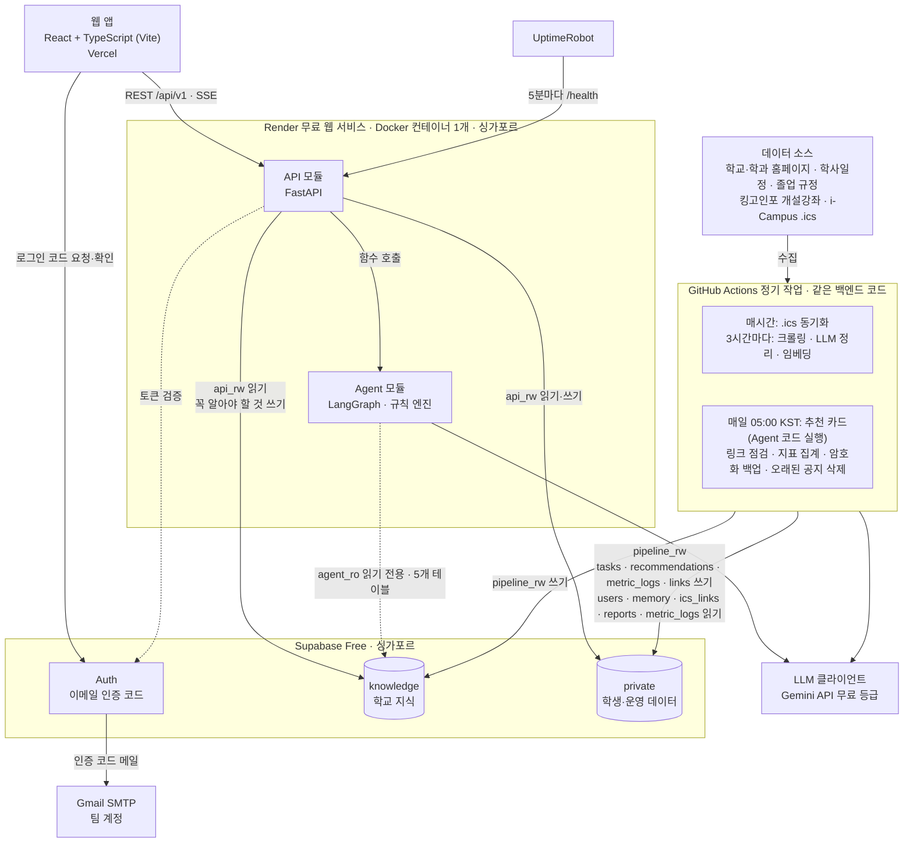

# SKKEY
 
**소프트웨어학과 학생과 교수를 위한 대학생활 종합 지원 시스템.**
흩어진 학교 정보와 할 일을 한 화면에 모으고, 학생을 기억하는 두 AI Agent가 행사 추천과 졸업 설계를 돕는다.
 
성균관대학교 소프트웨어공학개론 (SWE3002-41) 2조
 
README를 포함한 모든 변경은 각자의 포크에서 `develop`으로 PR을 올리고, 기능 단계가 끝날 때 `develop`을 `main`으로 릴리스한다(7절).
 
## 1. 제품 소개
 
학사일정, 과제, 장학, 졸업요건, 행사와 공지가 학교·학과 홈페이지, i-Campus, GLS, 게시판에 흩어져 있어 신입생은 무엇을 어디서 찾아야 하는지부터 모른다. SKKEY는 이 정보를 미리 모아 한 화면에 보여준다. 정보 수집과 정리는 수집 파이프라인(크롤러 + LLM 정리)이 맡고, AI Agent는 기억과 판단이 필요한 두 곳(행사 추천, 졸업 설계)에만 쓴다. 숫자와 순서(졸업 학점, 과목 배치, 오늘의 플랜)는 코드가 계산하고, LLM은 이해와 설명, 그리고 학생이 올린 GLS 스크린샷 읽기만 맡는다. LLM이 읽은 숫자는 코드가 검사하고 학생이 확인한 뒤에만 쓴다.
 
### 사용자
 
웹 앱 하나에 역할에 따라 화면이 더해진다. 노트북 화면이 기준이고, 모든 화면은 로그인한 뒤에만 보인다. 가입과 로그인은 학교 이메일(`@skku.edu`, `@g.skku.edu`)로 받은 6자리 인증 코드(10분 유효)로 한다. 7일 동안 요청이 없으면 로그아웃되고, 탈퇴하면 개인 데이터를 모두 지운다. 알림은 보내지 않고, 화면을 열면 경고 배너로 보여준다.
 
| 역할 | 주로 쓰는 기능 |
|---|---|
| 학생: 신입생 (주 사용자) | 할 일 관리, 오늘의 플랜, 꼭 알아야 할 것, 행사 추천. 첫 로그인 때 학번과 관심 분야를 답한다 |
| 학생: 재학생 | 졸업요건 Agent (진단, 로드맵, 학기별 추천 과목) |
| 교수 | 인턴십·연구실 공고 쓰기·고치기·내리기. 운영자가 계정을 승인한 뒤에 쓸 수 있다 |
| 운영자 (팀원) | 교수 승인, 오류 신고 처리, 꼭 알아야 할 것 선정, 공고·링크·졸업 규정 관리, 지표 화면. DB에서 직접 지정한다 |
 
### 기능
 
**Agent 없이 동작하는 기능**: DB에서 바로 읽거나 코드로 계산한다.
 
- **할 일 관리**: i-Campus 일정 파일(.ics)의 과제·퀴즈·강의·시험, 학사 마감, 신입생 필수 체크리스트가 자동으로 들어온다. 공지에서 찾은 기한은 후보로 보여주고 학생이 누르면 넣는다. 직접 추가와 공고 마감일 추가도 된다. 마감 24시간 안은 '임박', 지나면 '지연'으로 표시하고, 이번 주 완료율과 놓친 마감 수를 보여준다.
- **오늘의 플랜**: 코드(`plan_today`)가 마감, 예상 소요 시간, 가중치로 할 일을 정렬한다. 가중치는 학생이 ⚙ 설정에서 종류 순서(예: 강의 → 퀴즈 → 과제)를 직접 골라 정하고, 예상 소요 시간은 할 일마다 고칠 수 있다. 홈을 열 때, 할 일을 바꿀 때, '플랜 재설정'을 누를 때 다시 계산하며 AI와 LLM을 쓰지 않는다.
- **꼭 알아야 할 것**: 지금 모든 학생이 챙겨야 할 공지. 운영자가 올리고 내린다.
- **학교 소식**: 카테고리 트리(학교 전체, 학과, 장학, 동아리 모집, 신입생 필수), 글마다 한 줄 요약과 원문 링크. 모든 학생에게 같은 목록이다.
- **바로가기**: 학교 사이트 링크 모음. 매일 자동 점검한다.
- **인턴십·연구실 (교내 모집)**: 교수가 공고를 올리고, 학생은 교수에게 직접 연락한다. SKKEY 안에서 지원을 받지 않는다.

**캠퍼스 라이프 Agent**: 내 기억을 바탕으로 행사·특강·동아리를 카드로 추천한다.
 
- 카드는 매일 05:00(KST)에 최근 7일 안에 접속한 학생 것을 미리 만든다. 가입 질문을 마쳤을 때, ⚙ 설정이 바뀌었을 때, 7일 넘게 접속하지 않은 학생이 다시 들어왔을 때는 그 학생 것만 바로 한 번 만든다. 그래서 신입생도 가입 직후 첫 카드를 본다. 대화창과 추천 이유 표시는 없다.
- '관심 없음'을 누른 카드는 바로 숨기고, 반응은 다음 추천에 반영한다. '저장'한 카드는 저장한 카드 목록에서 다시 볼 수 있다.
- 끝난 행사와 신청 마감이 지난 행사는 뺀다. 날짜가 없는 항목은 게시 후 30일 동안 남긴다.
- 수업 시간과 겹치는 행사도 추천한다. 휴강은 수업 중에 직접 공지되는 경우가 많아 웹사이트로 알 수 없으므로, SKKEY는 휴강을 예측하지 않고 참여 여부는 학생이 판단한다.
- ⚙ 설정에 적은 글(예: "동아리는 개발 동아리만")을 추천 선호와 기억할 사실로 바꾼다. 이 글은 오늘의 플랜에는 쓰지 않는다.
- LLM을 쓸 수 없으면 관심 분야와 행사의 임베딩 유사도로 카드를 만든다.

**졸업요건 Agent** (채팅): 남은 졸업요건을 진단하고 목표 졸업 학기부터 역산한 로드맵과 추천 과목을 보여준다.
 
1. 학번, 이수 내역, 목표 졸업 학기가 없으면 먼저 묻는다. 이수 내역은 GLS 스크린샷으로 먼저 채우고, 학생이 고친다. 학생이 GLS 졸업요건 충족현황 화면을 캡처해 올리고 표 부분만 잘라 내면, LLM이 영역별 기준학점·취득학점을 읽어 이수 내역 입력 표를 미리 채운다. 학생은 그 표를 확인하고 틀린 칸을 직접 고친 뒤 저장하며, 저장 전의 값은 진단에 쓰지 않는다. 화면의 안내가 GLS 메뉴 위치와 캡처 방법을 그림으로 알려준다. 스크린샷 없이 영역별 학점이나 들은 과목을 처음부터 직접 입력해도 된다.
2. 규칙 엔진(`diagnose`)이 남은 학점, 필수 과목, 학번별 학과 졸업 평가 항목(연구논문·작품, 인턴십, 산학협력프로젝트, 1만라인프로젝트)을 계산한다.
3. 로드맵 빌더(`build_roadmap`)가 과목을 배치하고, 검증기(`verify`)가 학점 상한·선수과목·요건을 다시 검사한다. 목표 학기가 너무 이르면 가장 빠른 졸업 학기를 보여주고, 어느 학기로도 안 되는 조건이면 그 조건을 보여주고 묻는다.
4. LLM은 질문을 이해하고 결과를 설명하며 졸업 규정 조항을 인용한다. 학생 한 명당 하루 20개까지 질문할 수 있다.
5. 학생이 진단을 바로잡으면 졸업 규정과 대조한다. 맞으면 고치고 다시 진단하며, 우리 규칙 데이터가 틀렸으면 오류 신고를 자동으로 올린다. 다르면 조항을 보여주고, 판단할 수 없으면 '확인 필요'로 표시한다.
6. 학생은 어떤 답에서든 오류 신고를 할 수 있다. 운영자가 처리하고, 규칙 데이터 오류는 회귀 테스트 케이스가 된다.

**GLS 스크린샷 읽기가 실패하는 경우**
 
스크린샷은 LLM이 이미지로 읽으므로 숫자를 잘못 읽을 수 있다. 읽은 값은 코드가 다시 검사해 어긋난 칸을 표시하고, 학생이 확인·수정해 저장하기 전에는 진단에 쓰지 않는다.
 
| 경우 | 처리 |
|---|---|
| 표의 일부만 찍혀 영역이 빠짐 | 빠진 영역을 알려주고, 나머지를 다시 찍어 올리거나 직접 입력하게 한다 |
| 흐리거나 작은 글씨, `2(6)`, `3 / 0` 같은 표기를 잘못 읽음 | 코드가 세부 영역 합이 총학점과 맞는지, 잔여 = 기준 − 취득인지, 값이 가능한 범위인지 검사한다. 어긋난 칸은 '확인 필요'로 표시하고 학생이 고친다 |
| 없는 영역을 지어냄 | 그 학번 졸업 규칙의 영역 목록에 있는 영역만 받는다. 목록에 없는 영역은 버리고, 읽지 못한 칸은 비워 둔다 |
| 기준학점이 저장된 졸업 규정과 다름 | 읽기 실수일 수 있으므로 학생이 확인한 뒤에만 오류 신고를 올린다 |
| GLS 화면이 아닌 이미지 | 표를 만들지 않고 GLS 캡처 안내를 다시 보여준다 |
| 이름·학번이 함께 찍힘 | 올리기 전 자르기 단계에서 표 부분만 남긴다. 서버는 이미지를 저장하거나 로그에 남기지 않는다 |
| LLM을 쓸 수 없음(한도, 장애) | 빈 직접 입력 표를 보여준다 |
 
대상은 소프트웨어학과 단일전공이며, 시간표를 짜거나 수강신청을 대신하지 않는다.
 
**내 기억**: 관심 분야, 성향·가중치, 카드 반응, 대화에서 나온 사실, 학번·이수 내역을 학생마다 저장한다. 학생은 내 기억 페이지에서 보고, 고치고, 지울 수 있고, 탈퇴하면 모두 지워진다.
 
## 2. 시스템 구조
 
모듈형 모놀리스다. 백엔드 서버는 Render의 Docker 컨테이너 하나이고, 그 안의 API 모듈과 Agent 모듈은 함수 호출로 연결된다. 나머지는 설정해서 쓰는 무료 서비스다. 학교 정보는 GitHub Actions 정기 작업이 같은 백엔드 코드로 미리 모아 둔다.
 

 
| 구성요소 | 기술 · 위치 | 하는 일 | 담당 |
|---|---|---|---|
| 웹 앱 | React + TypeScript (Vite), Vercel | 모든 화면. 백엔드 API만 부른다 | FE |
| API 모듈 | FastAPI, Render 컨테이너 | 토큰 검증과 역할 확인, 홈·할 일·소식·카드·플랜 응답, 졸업요건 채팅 스트리밍(SSE), Agent 결과와 기억 저장 | BE |
| Agent 모듈 | LangGraph, 같은 컨테이너 | 캠퍼스 라이프 Agent, 졸업요건 Agent, 기억 정리 | AI·RAG |
| 규칙 엔진 | 순수 Python (`rules/`) | `plan_today`, `diagnose`, `build_roadmap`, `verify`. 같은 입력에 같은 결과 | AI·RAG |
| 수집 | GitHub Actions | 크롤링 → `raw_documents`, .ics 동기화 → `tasks`, 링크 점검 | BE |
| 정리 | GitHub Actions | LLM 정리(분류, 한 줄 요약, 기한), 임베딩(졸업요건 자료 포함) | AI·RAG |
| LLM 클라이언트 | google-genai를 감싼 작은 모듈 → Gemini API 무료 등급 | 공지 정리, ⚙ 설정, 채팅, GLS 스크린샷 읽기(이미지 입력) 모두 Flash-Lite가 기본이고 임베딩은 768차원이다. 실제 하루 한도는 우리 프로젝트의 AI Studio 화면에서 확인해 하루 예산으로 정한다. 예산을 넘거나 한도에 걸리면 채팅은 LLM 설명 없이 코드가 만든 결과 글만 보낸다 | AI·RAG |
| DB와 로그인 | Supabase Free (PostgreSQL + pgvector + Auth) | 스키마 두 개, DB 로그인 네 개, 이메일 인증 코드 | BE |
| 로그인 메일, uptime 모니터링 | Gmail SMTP, UptimeRobot | 인증 코드 메일 발송, 5분마다 `/health` 호출 | BE |
 
**DB**: 학교 지식은 `knowledge` 스키마(`notices`, `events`, `offered_courses`, `grad_rules`, `knowledge_chunks`, `raw_documents`), 학생·운영 데이터는 `private` 스키마(`users`, `memory`, `tasks`, `ics_links`, `transcripts`, `roadmaps`, `recommendations`, `chat_messages`, `reports`, `postings`, `links`, `metric_logs`)에 둔다. 졸업 규칙의 원본은 리포지토리의 YAML 파일이고, 배포할 때 `grad_rules`에 싣는다. 모든 DB 연결은 Supabase 연결 풀러 주소를 쓴다.
 
| DB 로그인 | 쓰는 곳 | 권한 |
|---|---|---|
| `api_rw` | API 모듈 | `private` 읽기·쓰기, `knowledge` 읽기, 꼭 알아야 할 것 데이터 쓰기 |
| `agent_ro` | Agent 모듈 | `notices`, `events`, `offered_courses`, `grad_rules`, `knowledge_chunks` 읽기만 |
| `pipeline_rw` | 정기 작업 | `knowledge` 쓰기(배포 때 졸업 규칙 YAML 싣기 포함), `tasks`·`recommendations`·`metric_logs`·`links` 쓰기, `users`·`memory`·`ics_links`·`reports`·`metric_logs` 읽기 |
| `backup_ro` | 매일 백업 | `private` 읽기 |
 
**정기 작업**
 
| 워크플로 | 실행 시점 | 하는 일 |
|---|---|---|
| `ci.yml` | `develop`·`main`으로 가는 모든 PR | 정적 분석, 단위 테스트, 인터페이스 테스트, 졸업요건 회귀 테스트(LLM은 녹화한 응답을 재생해 실제 호출 0회), 졸업 규칙 YAML 형식 검사. 포크에서 온 PR에도 돌도록 Secrets 없이 실행하고, DB 테스트는 CI 안의 임시 PostgreSQL에서 한다. `main`으로 가는 PR은 source 브랜치가 `develop`인지도 검사한다 |
| `release-staging.yml` | `develop` 병합 | staging에 마이그레이션 적용 → 졸업 규칙 YAML 싣기 → staging Render deploy hook → `/health` 확인 → Vercel CLI로 preview 배포 후 고정 staging 주소에 연결 → staging에서 E2E 테스트(Playwright) |
| `release.yml` | `main` 병합(`develop`에서 온 릴리스 PR) | 운영에 마이그레이션 적용 → 졸업 규칙 YAML을 `grad_rules`에 싣기 → Render deploy hook → `/health` 확인 → Vercel CLI로 운영 배포. Render 자동 배포는 꺼 둔다 |
| `pipeline-hourly.yml` | 매시간 | .ics 동기화. 3시간마다 크롤링, LLM 정리, 임베딩도 함께. 운영 환경에서만 돌고, staging은 필요할 때 손으로 실행한다 |
| `pipeline-daily.yml` | 매일 05:00 (KST) | 추천 카드, 링크 점검, 지표 집계, `private` 암호화 백업, 2학기 지난 공지 삭제. 운영 환경에서만 돈다 |
| `pipeline-semester.yml` | 학기마다 손으로 실행 | 학과 졸업요건·교육과정 페이지, 학사일정, 개설강좌 수집. 운영 환경에서만 돈다 |
 
예약 작업이 정각에 몰리면 늦게 시작할 수 있어, cron의 분은 정각을 피한다(예: `17 * * * *`).
 
**실행 환경**

코드는 GitHub에 두지만, 서비스는 아래 호스팅에서 돈다. 학생은 운영 웹 주소를 브라우저로 열기만 하면 되고, 팀원 컴퓨터에서 서버를 켜 둘 필요는 없다.

| 환경 | 코드 | 웹 (Vercel) | 백엔드 (Render) | DB와 로그인 (Supabase) | 쓰는 사람 |
|---|---|---|---|---|---|
| 로컬 | 내 feature 브랜치 | `localhost:5173` | `docker compose up`, `localhost:8000` | Supabase 로컬(`supabase start`) | 개발하는 팀원 |
| staging | `develop` | 고정 staging 주소 [TBD] | 무료 웹 서비스 2 (잠들어도 됨, UptimeRobot 없음) | Free 프로젝트 2 | 팀원의 통합 테스트 |
| 운영 | `main` | 운영 주소 [TBD] | 무료 웹 서비스 1 (UptimeRobot 5분 확인) | Free 프로젝트 1 | 학생, 교수, 운영자 |

- 환경마다 설정 값이 다르다: 웹의 `VITE_API_URL`, 백엔드의 `ALLOWED_ORIGINS`와 DB 주소 4개, Gemini 키. staging은 다른 Google 프로젝트의 Gemini 키를 써서 테스트가 운영의 하루 한도를 쓰지 않게 한다.
- staging DB는 일주일 동안 쓰지 않으면 Supabase가 멈추므로, 멈췄으면 대시보드에서 다시 켠다.
 
**원칙**
 
- 화면은 백엔드 API만 부른다. 로그인 코드 요청·확인만 Supabase Auth와 직접 한다.
- Agent 모듈은 DB에 쓰지 않는다. 결과와 기억은 제안만 하고, API나 정기 작업이 저장한다.
- Agent 모듈은 학교 지식만 읽는다. 학생 데이터는 API가 요청마다 한 명분만 넘기며, 이름과 이메일은 넣지 않는다.
- LLM을 실시간으로 부르는 곳은 졸업요건 채팅, GLS 스크린샷 읽기, ⚙ 설정의 글 저장 세 곳뿐이다. 오늘의 플랜을 포함한 나머지는 코드로 계산하거나 미리 만든다.
- LLM에 장애가 있어도 정보 기능은 그대로 동작한다.

**보안과 수집**
 
- 학교 계정 비밀번호를 받지 않는다. 이수 내역은 학생이 입력하거나 GLS 스크린샷으로 채우고, i-Campus는 .ics 주소로만 연결해 암호화 저장한다.
- LLM에는 요청한 학생 본인 데이터만 보내고, 이름과 이메일은 보내지 않는다. GLS 스크린샷은 올리기 전에 화면에서 표 부분만 잘라 이름·학번이 보내지지 않게 하고, 서버는 이미지를 메모리에서만 다룬 뒤 버린다(저장·로그 없음). Gemini 무료 등급 입력(스크린샷 포함)이 Google 제품 개선에 쓰일 수 있음을 가입 동의 화면에서 알린다. 졸업요건 채팅 입력창 위에 "이름, 학번, 연락처 같은 개인정보는 입력하지 마세요"를 늘 보여준다.
- 로그에는 개수와 상태만 남긴다. httpx 로그는 WARNING 이상만 남기고, 이름·이메일·.ics 주소·프롬프트 본문은 어떤 로그에도 남기지 않는다. 리포지토리가 공개라 GitHub Actions 로그도 누구나 볼 수 있다.
- 모든 `private` 테이블에 RLS(행 수준 보안)을 켜고 브라우저 역할에는 정책을 주지 않는다.
- 시크릿(DB 주소, Gemini 키, .ics 암호화 키, `VERCEL_TOKEN`)은 Render 환경 설정과 GitHub Secrets에만 둔다. 리포지토리는 공개다.
- `private` 백업은 `age`로 암호화해 7일만 보관한다.
- 공개 페이지만 수집하고, robots.txt를 지키며, 사이트마다 초당 1회 이하로 요청하고, 프로젝트를 밝히는 User-Agent를 쓴다. 같은 글은 URL과 내용 해시로 한 번만 저장하고, 공지는 2학기 동안만 보관한다.
- 학과 홈페이지의 졸업요건·교육과정·로드맵 페이지와 PDF는 학기마다 수동 실행으로 다시 가져오고, 바뀌면 학교 지식의 예전 청크를 바꾸거나 지운다. 학기 중 졸업요건 변경 공지는 학과 공지 크롤링으로 들어오며, 이런 공지를 찾으면 운영자 확인 작업을 만든다. 사람이 하는 일은 두 가지뿐이다. 학점 기준이 바뀌면(학교 학점이수표, 학과 공지) 운영자가 학기마다 확인해 졸업 규칙 YAML에 옮겨 넣어 PR로 올리고, 학생은 자기 GLS 스크린샷을 올리고 확인한다. 크롤러는 규칙 데이터를 직접 고치지 않고, GLS에 로그인하지 않는다.

**확장성과 한계**
 
지금은 무료 등급(Render, Supabase Free, Gemini 무료)에 맞춰 서버 하나로 시작한다. 바깥 서비스는 인터페이스 뒤에 두어, 바꿀 때 고치는 곳이 그 모듈의 설정에 머물게 한다. 다만 무료 등급에는 돈을 내야만 풀리는 한계가 있으므로, 한계마다 지금 값, 확인하는 방법, 바꾸는 곳을 적는다. 측정값은 테스트하면서 채운다.
 
| 한계 | 지금 | 확인하는 방법 | 바꾸는 곳 |
|---|---|---|---|
| 백엔드 서버 | Render 무료: 메모리 512MB, 15분 동안 요청이 없으면 잠들고 깨는 데 약 1분 | Render 메모리 그래프, UptimeRobot 가동률 | 같은 Docker 이미지로 유료 Render나 Cloud Run |
| 동시 사용자 | 목표 100명 | 부하 테스트로 한계점(홈 P95가 3초를 넘는 사용자 수)을 잰다 | 서버 사양, Agent 별도 서버(`AGENT_MODE=remote`, `AGENT_URL`) |
| LLM 호출 | Gemini 무료 등급. 하루 한도는 프로젝트마다 다르다 | AI Studio의 한도 화면, `llm/`의 하루 호출 수 | `backend/skkey/llm/models.yaml`, 유료 키 |
| LLM 입력 | 무료 등급 입력은 Google 제품 개선에 쓰일 수 있다 | 프롬프트 개인정보 검사 테스트 | 유료 등급 |
| DB | Supabase Free: 저장 공간 500MB | DB 크기, 공지 2학기 보관 | `DATABASE_URL_API`, `DATABASE_URL_AGENT`, `DATABASE_URL_PIPELINE`, `DATABASE_URL_BACKUP` |
| 정기 작업 | GitHub Actions 예약 작업은 늦게 시작할 수 있다 | 작업 기록의 시작 시각 | 다른 스케줄러 |
| 임베딩 | 768차원 | 상위 5개 조회 시간 | `EMBEDDING_MODEL`, `EMBEDDING_DIM` 후 재임베딩 작업 실행 |
| 수집 범위 | 소프트웨어학과 | | `backend/skkey/pipeline/sources.yaml` |
| 캐시, 로그인 메일 | 캐시 없음, Gmail SMTP | | `CACHE_BACKEND=redis`, Supabase SMTP 설정 |
 
```python
# backend/skkey/main.py (계획)
def build_agent(settings: Settings) -> AgentFacade:
    # AGENT_MODE만 바꾸면 구현체가 바뀐다. 호출하는 쪽은 고치지 않는다
    if settings.agent_mode == "remote":
        return HttpAgentClient(settings.agent_url)
    return InProcessAgent()
```
 
```yaml
# backend/skkey/llm/models.yaml (계획)
# 위에서부터 차례로 쓰고, 하루 예산이나 한도에 걸리면 다음으로 넘어간다. code_text는 LLM 없이 코드가 만든 결과 글이다.
chat:                  # 졸업요건 채팅
  - flash-lite          # 기본. 하루 예산은 AI Studio에서 확인한 한도로 정한다
  - code_text
cleanup:               # 공지 정리, ⚙ 설정
  - flash-lite
```
 
## 3. 팀 구성과 담당
 
| 팀 | 사람 | 맡는 것 |
|---|---|---|
| FE | 권유민, 김호준 | `web/`: 학생·교수·관리자·지표 화면 전부, 화면 테스트 |
| BE | 강민주, 최영훈 | API(`api/`, `db/`), 수집(`pipeline/collect/`: 크롤러, .ics 동기화, 링크 점검), DB(`supabase/`), 로그인 설정, 배포와 정기 작업 |
| AI·RAG | 박연우, 성민호, 이건 | Agent(`agent/`), 규칙 엔진(`rules/`), LLM 클라이언트(`llm/`), 정리(`pipeline/process/`), 평가 데이터(`evaluation/`), 졸업 규칙 YAML(`rules/data/`) |
| 통합 담당 | 성민호 (AI·RAG) | 인터페이스 정의(`contracts/`), `FakeAgent`, CI(`ci.yml`), 리포지토리 규칙(`CODEOWNERS`, `main`·`develop` 보호), 릴리스 PR(`develop` → `main`), 평가 데이터, 지표 집계와 주간 보고, 부하 테스트 |
 
**팀 안의 역할**
 
| 역할 | 맡는 일 | 이름 |
|---|---|---|
| FE-1 | 학생 화면: 로그인·가입(개인정보 동의, 학생·교수 분기, 로그아웃), 홈, 소식, 졸업요건 채팅과 이수 내역, 로드맵, 내 기억, 공고 목록. 컴포넌트 테스트 | 권유민 |
| FE-2 | 교수 화면(승인 대기, 본인 공고), 관리자·지표 화면, 생성된 API 클라이언트, SSE 읽기, MSW mock, 데이터 갱신 규칙, 기준선 측정, Playwright 테스트 | 김호준 |
| BE-1 | `api/`, `db/`, 로그인 설정·세션 만료·탈퇴, 마이그레이션(`private` 스키마, DB 로그인, RLS), 졸업요건 채팅 SSE, GLS 스크린샷 받기와 확인한 표 저장, 권한 테스트, 백업·로컬 개발 환경(BE-2와 공동, 주담당) | 최영훈 |
| BE-2 | 마이그레이션(`knowledge` 스키마, `raw_documents`), 크롤러, .ics 동기화, 링크 점검, 워크플로와 배포(BE-1과 공동, 주담당) | 강민주 |
| AI·RAG-1 | 규칙 엔진(`plan_today`, `diagnose`, `build_roadmap`, `verify`), 졸업 규칙 YAML, 학생 정정 대조(`check_claim`), 회귀 사례화 | 이건 |
| AI·RAG-2 | 졸업요건 Agent, GLS 스크린샷 읽기, 캠퍼스 라이프 Agent, ⚙ 설정 해석, 공지 정리·임베딩, LLM 클라이언트 | 박연우 |
| AI·RAG-3 | 통합 담당: 인터페이스, `FakeAgent`, CI, 평가 데이터, 지표 집계와 주간 보고, 부하 테스트 | 성민호 |
 
**여러 팀이 나눠 맡는 일**
 
| 일 | 나누는 방법 |
|---|---|
| 크롤러 → 공지 정리 | 페이지를 가져와 `raw_documents`에 저장하는 것까지 BE, 글을 이해하고 정리하는 것부터 AI·RAG |
| 졸업 규정 → `grad_rules` | 규칙 YAML과 그 형식은 AI·RAG, 테이블과 배포 때 싣는 단계는 BE, 학점 기준 입력은 운영자 |
| 오늘의 플랜 | `plan_today`는 AI·RAG, 엔드포인트는 BE, 화면은 FE |
| 매일 추천 카드 | 카드 만드는 함수는 AI·RAG, 매일 작업 실행은 BE |
| 졸업요건 채팅 | 답변 생성은 AI·RAG, SSE 전달은 BE, 화면은 FE |
| 오류 신고 | 버튼과 관리자 화면은 FE, API와 테이블은 BE, 자동 신고와 회귀 사례화는 AI·RAG |
| 로그인 | Supabase 설정, 도메인 트리거, 토큰 검증은 BE, 로그인 화면은 FE |
| 지표 | 팀마다 자기 이벤트를 기록하고, 정의·집계·주간 보고는 통합 담당, 집계 작업 실행과 `metric_logs` 테이블은 BE, 차트는 FE |
 
## 4. 리포지토리 구조
 
```text
skkey/
├── web/                        # FE · React + TypeScript (Vite) → Vercel
│   └── src/api/generated/      # OpenAPI 명세로 만든 TS 클라이언트 (손으로 고치지 않음)
├── backend/                    # Docker 이미지 하나 → Render
│   ├── Dockerfile
│   ├── skkey/
│   │   ├── main.py             # 통합 담당 · 실제 구현체를 연결하는 유일한 곳
│   │   ├── contracts/          # 통합 담당 · 팀 사이 인터페이스 정의 (api.py는 BE)
│   │   ├── api/                # BE · FastAPI 라우트, 서비스
│   │   ├── db/                 # BE · DB 로그인별 연결, repository 계층
│   │   ├── agent/              # AI·RAG · 캠퍼스 라이프, 졸업요건, 기억 정리
│   │   ├── rules/              # AI·RAG · 규칙 엔진, 검증기, 로드맵 빌더, 플랜 점수, data/ 졸업 규칙 YAML
│   │   ├── llm/                # AI·RAG · Gemini 클라이언트: 모델 순서, 하루 예산, 개인정보 검사
│   │   └── pipeline/
│   │       ├── collect/        # BE · 크롤러, .ics 동기화, 링크 점검
│   │       └── process/        # AI·RAG · LLM 정리, 임베딩
│   └── tests/                  # 각 코드의 담당 팀이 작성
├── docker-compose.yml          # BE · 로컬에서 웹과 백엔드를 명령 하나로 실행
├── supabase/
│   ├── migrations/             # BE · 스키마, DB 로그인, 권한 (SQL)
│   └── seed/                   # 테스트 데이터
├── evaluation/                 # AI·RAG · 라벨링한 샘플 (M-01, M-02, M-10–M-14)
└── .github/
    ├── workflows/              # ci.yml은 통합 담당, 나머지는 BE
    ├── CODEOWNERS              # 통합 담당 · 폴더별 리뷰어 자동 지정
    └── pull_request_template.md # 통합 담당 · PR 설명 양식
```
 
## 5. 인터페이스
 
팀이 만나는 곳은 세 군데다. 각 인터페이스는 파일 하나로 정의하고, 제공하는 팀이 Sprint 0에 먼저 만든다. 사용하는 팀은 실제 구현이 준비될 때까지 mock으로 개발하므로 서로 기다리지 않는다.
 
| 인터페이스 | 제공 → 사용 | 정의 파일 | 준비 전 mock | 자동 확인 |
|---|---|---|---|---|
| 웹 ↔ API | BE → FE | `contracts/api.py` → `/api/v1/openapi.json` | MSW mock | Schemathesis, 생성된 클라이언트 타입 검사 |
| API ↔ Agent | AI·RAG → BE | `contracts/agent.py` | `FakeAgent` | mypy, `FakeAgent`와 실제 Agent가 같은 테스트 통과 |
| 수집 ↔ 정리 | BE → AI·RAG | `supabase/migrations/` (`raw_documents`) | 샘플 행 | CI의 임시 PostgreSQL에 마이그레이션 적용, 샘플 행으로 정리 테스트 |
 
- Sprint 0이 끝나면 인터페이스를 고정한다. 이후에는 PR로만 바꾸고, 영향을 받는 다른 팀의 리뷰어가 승인해야 병합한다. `/api/v1`은 하위 호환을 지키고, 호환이 깨지면 새 버전으로 낸다.
- 기능은 `develop`에 작게 자주 합친다. 기능 단계가 끝나면 staging에서 E2E 테스트가 통과해야 그 단계가 통합된 것이고, 그때 `develop`을 `main`으로 릴리스한다(7절).

### 웹 ↔ API (REST)
 
기준 경로는 `/api/v1`, 형식은 JSON, 요청에는 `Authorization: Bearer <token>`을 담는다. 오류 형식은 하나다: `{"error": {"code": "...", "message": "..."}}`. 오류 코드는 `unauthorized`, `forbidden`, `not_found`, `validation_error`, `input_too_long`, `chat_limit_exceeded`, `llm_unavailable`로 정하고, 졸업요건 채팅도 스트림을 열기 전의 오류(401, 하루 한도 초과, 길이 초과)는 이 형식으로 보낸다.
 
| 엔드포인트 | 호출자 | 용도 |
|---|---|---|
| `GET /me` | 모두 | 프로필, 역할, 교수 승인 상태(`pending`, `approved`, `rejected`), ⚙ 설정 값(종류 순서, 추천에 쓰는 글), i-Campus 연결 여부(`ics_connected`, 주소는 내려주지 않음), 오늘 남은 졸업요건 질문 수 |
| `POST /me/onboarding` | 모두 | 첫 로그인: 개인정보 동의 여부와 시각, 역할. 학생은 학번과 관심 분야(고정 목록), 교수는 소속과 연구 분야를 보내 교수 신청이 된다 |
| `DELETE /me` | 모두 | 탈퇴: 계정과 개인 데이터를 모두 지운다 |
| `GET /home` | 학생 | 홈 한 번에: 경고 배너, 할 일(최대 50개), 오늘의 플랜, 꼭 알아야 할 것, 카드(최대 6개, 준비 중 상태 포함), 칸마다 마지막으로 받은 시각(i-Campus 동기화, 카드 생성) |
| `GET/POST /tasks`, `PATCH/DELETE /tasks/{id}` | 학생 | 할 일 목록, 직접 추가, 완료 체크, 예상 소요 시간 고치기, 삭제(직접 추가한 일만) |
| `PUT/DELETE /me/ics-link` | 학생 | i-Campus 연결, 해제 |
| `GET /tasks/candidates`, `POST /tasks/candidates/{id}/accept`, `POST /tasks/candidates/{id}/dismiss` | 학생 | 공지에서 찾은 기한 후보, 수락, 거절 |
| `POST /plan/reset` | 학생 | 오늘의 플랜 다시 계산 |
| `GET /notices?category=`, `GET /must-know` | 모두 | 소식, 꼭 알아야 할 것 |
| `GET /recommendations`, `GET /recommendations?saved=true`, `POST /recommendations/{id}/reaction` | 학생 | 카드, 저장한 카드 목록, `saved` 또는 `not_interested` |
| `PUT /me/settings` | 학생 | ⚙ 설정 저장: 플랜의 종류 순서, 추천에 쓰는 글 |
| `GET/PUT /transcript` | 학생 | 이수 내역과 영역별 학점 (직접 입력, 확인한 GLS 표 저장) |
| `POST /transcript/gls-image` | 학생 | GLS 스크린샷(PNG·JPEG, 5MB 이하)을 읽은 표. 저장하지 않으며, 학생이 확인·수정한 뒤 `PUT /transcript`로 저장한다 |
| `POST /graduation/chat` (SSE) | 학생 | 졸업요건 채팅 |
| `GET /roadmap`, `POST /roadmap/verify` | 학생 | 마지막 로드맵 조회, 후보 과목을 바꾼 로드맵 재검증(통과하면 저장) |
| `POST /reports`, `GET /reports/mine` | 학생 | 오류 신고와 처리 결과 |
| `GET /memory`, `PATCH/DELETE /memory/{id}` | 학생 | 내 기억. 항목마다 들어온 경로(`source`: `signup`, `setting`, `reaction`, `chat`, `user_edit`)를 담는다 |
| `GET /postings`, `POST /postings/{id}/to-tasks` | 학생 | 공고 목록, 마감일을 할 일에 넣기 |
| `GET /postings?mine=true` | 승인된 교수 | 본인이 올린 공고 목록 |
| `POST /postings` | 승인된 교수 | 공고 쓰기 |
| `PATCH/DELETE /postings/{id}` | 승인된 교수(본인 공고), 운영자(내리기만) | 공고 고치기, 내리기 |
| `GET /links` | 모두 | 바로가기 |
| `/admin/professors`, `/admin/reports`, `/admin/must-know`, `/admin/links`, `/admin/metrics` | 운영자 | 관리자 기능 |
| `GET /health` | UptimeRobot | 백엔드와 DB 상태 |
 
채팅은 `status`(진행 상태: 이수 내역 읽는 중, 진단 중, 로드맵 만드는 중), `result`(코드가 검사한 진단, 로드맵, 과목), `citation`(졸업 규정 조항), `needs_check`(확인 필요), `token`(설명 글), `done` 순서로 보낸다. 설명 글은 검사한 결과를 보낸 뒤에만 보내고, `error`는 언제든 스트림을 끝낼 수 있다. `done`에는 오늘 남은 질문 수를 담는다. 이벤트마다 담는 내용(payload)은 `contracts/`에 Pydantic 모델로 정의하고, FE는 거기서 만든 TS 타입을 쓴다.
 
### API ↔ Agent
 
API는 `contracts/`에 선언된 아래 함수만 부른다. 실제 구현은 `main.py`에서 연결하고, BE는 통합 담당이 인터페이스와 함께 만드는, 고정된 답을 주는 `FakeAgent`로 먼저 개발한다.
 
```python
class AgentFacade(Protocol):
    async def recommend(self, ctx: StudentContext, candidates: list[EventRef]) -> list[Card]: ...
    async def interpret_settings(self, ctx: StudentContext, text: str) -> SettingsResult: ...  # 추천 선호 + 기억할 사실 (플랜에는 쓰지 않음)
    def graduation_chat(self, ctx: StudentContext, transcript: Transcript,
                        history: list[ChatTurn], message: str) -> AsyncIterator[ChatEvent]: ...
    async def check_claim(self, ctx: StudentContext, course_code: str, claimed_area: str) -> ClaimCheck: ...
    async def read_gls_image(self, ctx: StudentContext, image: bytes, mime: str) -> GlsTable: ...  # 읽기만 하고 저장하지 않음
 
class RuleEngine(Protocol):  # rules/의 순수 함수. 입출력과 LLM 없음
    def plan_today(self, tasks: list[Task], weights: Weights, now: datetime) -> Plan: ...
    def diagnose(self, transcript: Transcript, rules: list[GradRule]) -> Diagnosis: ...
    def build_roadmap(self, d: Diagnosis, target: Semester, credits: int, offerings: list[Offering]) -> Roadmap: ...
    def verify(self, roadmap: Roadmap, rules: list[GradRule]) -> list[Violation]: ...
```
 
- `StudentContext`: 익명 학생 id, 입학년도, 관심 분야, 가중치, 반응 요약, 저장된 사실. 이름과 이메일은 넣지 않는다.
- `ChatEvent`의 `MemoryUpdate`는 제안일 뿐이고, 저장은 API가 한다.
- `ClaimCheck`는 `match`, `mismatch`, `unverifiable`와 인용, `rule_conflict`를 돌려준다. `rule_conflict`가 참이면 API가 오류 신고를 올린다.
- `Roadmap`에는 실제로 쓴 졸업 학기가 들어간다.

### 수집 ↔ 정리
 
`knowledge.raw_documents`(`id`, `source`, `url`(유일), `title`, `posted_at`, `html`, `text`, `content_hash`, `fetched_at`, `processed_at`)가 넘겨받는 곳이다.
 
1. 수집은 `processed_at`을 비운 채 새 행을 넣는다.
2. 정리는 그 행을 읽어 `notices`, `events`, `knowledge_chunks`를 채우고 `processed_at`을 기록한다.

두 단계는 따로 실행하고, 실패하고, 재배포할 수 있다.
 
## 6. 팀별 개발 항목
 
각 항목은 완료 기준을 모두 만족해야 끝난 것이다. 괄호 안은 담당 역할(3절)과 단계다. 단계는 Sprint 0(인터페이스와 뼈대) 다음 1 로그인·할 일, 2 학교 소식·꼭 알아야 할 것, 3 추천 카드·설정, 4 졸업요건 진단, 5 로드맵·추천 과목·오류 신고, 6 인턴십·연구실·내 기억·관리자·지표 순서다. 지표는 이름 뒤에 번호(M-xx)를 붙여 적었다. 모든 항목은 담당 역할 하나와 다른 팀의 리뷰어 하나를 둔다. 규칙 엔진을 만드는 사람은 그 평가 사례를 쓰지 않는다(평가 데이터는 통합 담당).
 
### FE

| 개발 항목 | 만드는 것 | 완료 기준 |
|---|---|---|
| API 클라이언트와 mock<br>(FE-2 · Sprint 0) | BE의 `/api/v1/openapi.json`으로 `web/src/api/generated/`를 만든다(openapi-typescript + openapi-fetch). 손으로 고치지 않고, 명세가 바뀌면 다시 만든다. 같은 명세로 MSW mock을 만들어 엔드포인트가 준비되기 전에도 화면을 개발한다. 졸업요건 채팅은 POST에 토큰 헤더를 담는 SSE라 브라우저 `EventSource`를 쓸 수 없으므로, fetch 기반 스트림(@microsoft/fetch-event-source)으로 읽는다. 이벤트 타입은 `contracts/`에서 내보낸 TS 타입을 쓴다. | 다시 만든 뒤 tsc 오류 0건<br>모든 엔드포인트와 SSE 이벤트 종류마다 mock 응답이 있음 |
| 데이터 갱신과 실패 처리<br>(FE-2 · Sprint 0, 이후 모든 단계) | 서버 데이터는 TanStack Query(openapi-react-query)로 불러오고, 데이터를 바꾼 뒤 영향을 받는 조회를 다시 불러온다. 예: 할 일 체크·추가·삭제·예상 시간 수정 → `GET /home`을 다시 불러 할 일 목록과 오늘의 플랜을 갱신, 카드 반응 → 카드 목록, 공고 등록 → 교수 본인 공고 목록. 응답을 기다리지 않고 화면부터 바꾸는 곳(관심 없음, 할 일 체크)은 저장에 실패하면 원래 상태로 되돌리고 "저장하지 못했어요. 다시 시도해 주세요"를 보여준다. 401이 오면 로그인 화면으로 보낸다. | 저장 실패를 일부러 냈을 때 화면이 원래 상태로 돌아감<br>바뀐 데이터가 새로 고침 없이 관련 화면에 반영됨 |
| 로그인·가입 화면<br>(FE-1 · Sprint 0–1) | 학교 이메일 입력 → 6자리 코드 입력(supabase-js로 Supabase Auth에 직접) → 개인정보 동의 → 첫 로그인 질문. 동의 화면은 수집 항목, LLM에는 본인 데이터만 이름·이메일 없이 보낸다는 것, Gemini 무료 등급 입력이 Google 제품 개선에 쓰일 수 있다는 것을 알리고, 동의 여부와 시각을 `POST /me/onboarding`에 담는다. 첫 로그인 질문은 역할을 먼저 고른다. 학생은 학번과 관심 분야(AI·RAG가 정한 고정 목록에서 고르기)를 답하고 홈으로 간다. 교수는 교수 신청(소속, 연구 분야)을 보내고 승인 대기 화면으로 간다. 받은 토큰을 모든 API 요청에 담는다. 로그아웃은 supabase-js `signOut`과 함께 불러온 데이터 캐시를 비운다. | 학교 이메일로 가입·로그인 후 역할에 맞는 화면으로 이동<br>gmail.com 주소와 10분 지난 코드는 오류 안내<br>동의하지 않으면 가입이 끝나지 않음<br>로그아웃 후 다른 계정으로 로그인해도 이전 사용자 데이터가 보이지 않음 |
| 홈<br>(FE-1 · 1, 3) | `GET /home` 한 번으로 경고 배너(임박·지연, 이번 주 완료율, 놓친 마감 수), 할 일 목록(마감순, 임박·지연 표시, 체크 `PATCH /tasks/{id}`, 직접 추가 `POST /tasks`, 직접 추가한 일 삭제 `DELETE /tasks/{id}`), 기한 후보(`GET /tasks/candidates`, 수락, 거절 `POST /tasks/candidates/{id}/dismiss`), 오늘의 플랜(재설정 `POST /plan/reset`), 꼭 알아야 할 것, 추천 카드(저장·관심 없음 `POST /recommendations/{id}/reaction`)를 그린다. 관심 없음은 응답을 기다리지 않고 바로 숨긴다. 카드가 준비 중이면 "추천을 준비하고 있어요"를 보여주고 잠시 뒤 다시 불러오며, 맞는 행사가 없으면 "이번 주에는 맞는 행사가 없습니다"를 보여준다. 칸마다 마지막으로 받은 시각을 표시하고, 한 칸이 실패해도 다른 칸은 그대로 그린다. i-Campus 연결(`PUT /me/ics-link`)과 해제, 연결 상태 표시, 할 일마다 예상 소요 시간 고치기, ⚙ 설정(기존 값을 불러와 플랜의 종류 순서를 고르는 칸과 추천에 쓰는 글 칸을 보여주고 `PUT /me/settings`로 저장)도 여기서 한다. | 오늘 마감인 할 일이 클릭 없이 보임<br>할 일을 체크하면 플랜이 다시 정렬됨<br>관심 없음을 누르면 카드가 바로 사라지고, 저장에 실패하면 다시 나타남<br>⚙ 설정을 열면 저장해 둔 값이 보임<br>i-Campus 동기화가 실패한 상태에서도 다른 칸이 정상으로 보이고, 할 일 칸에 마지막 동기화 시각이 보임 |
| 학교 소식·바로가기<br>(FE-1 · 2) | 카테고리 트리(학교 전체, 학과, 장학, 동아리 모집, 신입생 필수)와 최신순 목록, 한 줄 요약, 원문 링크(`GET /notices?category=`, `GET /must-know`). 바로가기 모음(`GET /links`). | 소식을 누르면 원문 페이지로 이동<br>목록이 학생마다 같음 |
| 졸업요건 화면<br>(FE-1 · 4, 5) | 왼쪽은 이수 내역 표(영역별 학점이나 과목, `PUT /transcript`), 오른쪽은 채팅(`POST /graduation/chat`, SSE). 이수 내역 표 위의 'GLS 스크린샷으로 채우기': 이미지를 고르거나 붙여 넣고(Ctrl+V) → 표 부분만 잘라 내고(이름·학번 제외) → 긴 변 2,000px 이하로 줄여 `POST /transcript/gls-image`로 보낸다. 돌아온 값으로 표를 미리 채우고 '확인 필요' 칸을 강조하며, 학생이 고친 뒤 저장 버튼을 눌러야 `PUT /transcript`로 저장한다. 채팅 입력은 질문 하나이고 500자를 넘으면 보내지 않고 남은 글자 수를 보여준다. `status`는 진행 표시로, `token`은 설명 글을 이어 붙이고, `result`는 남은 학점 표·학기별 로드맵·추천 과목, `citation`은 근거 조항 링크, `needs_check`는 '확인 필요'로 그린다. GLS 메뉴 위치와 캡처 방법(Windows `Win+Shift+S`, macOS `Cmd+Shift+4`)은 그림 3단계로 안내한다(처음 한 번, '?'로 다시 열기. 그림의 이름·학번은 가린다). 입력창 위에 개인정보를 입력하지 말라는 안내를 늘 보여준다. 오늘 남은 질문 수를 보여주고, 다 쓰면 입력창을 막는다. 오류는 두 가지로 처리한다. 스트림 시작 전 JSON 오류(401, 한도 초과)는 오류 코드에 맞는 안내를, 스트림 중 `error`는 받은 글을 남긴 채 "잠시 후 다시 시도해 주세요"를 보여준다. 화면을 다시 열면 마지막 로드맵을 불러온다(`GET /roadmap`). 로드맵의 선택 영역 과목 옆에 후보 과목을 보여주고, 학생이 후보를 고르면 `POST /roadmap/verify`로 다시 검증해 통과하면 바꾼 로드맵을, 통과하지 못하면 맞출 수 없는 조건을 보여준다. 답마다 오류 신고 버튼(`POST /reports`)과 내 신고 결과(`GET /reports/mine`). | 질문 전송 후 3초 안에 서버의 `status` 이벤트가 화면에 표시됨<br>이벤트 종류와 두 가지 오류마다 컴포넌트 테스트 통과<br>하루 20개를 넘으면 안내 표시<br>화면을 다시 열어도 마지막 로드맵이 보임<br>스크린샷이 표를 미리 채우고, 저장 버튼 전에는 진단에 쓰이지 않음<br>자르기 단계를 거치지 않은 이미지는 보내지 않음<br>후보 과목을 고르면 10초 안에 다시 검증한 로드맵이나 위반 조건이 보임 |
| 내 기억·공고 목록<br>(FE-1 · 6) | 내 기억 종류별 목록과 들어온 경로, 고치기·지우기(`GET /memory`, `PATCH/DELETE /memory/{id}`). 페이지 아래에 탈퇴 버튼(한 번 더 확인한 뒤 `DELETE /me`, 끝나면 로그아웃). 인턴십·연구실 공고 목록과 마감일을 할 일에 넣기(`POST /postings/{id}/to-tasks`). 저장한 카드 목록(`GET /recommendations?saved=true`)도 여기에 두고, 끝난 행사는 '종료'로 표시한다. | 지운 기억이 다음 추천에 쓰이지 않음<br>공고 마감일이 할 일에 들어감 |
| 교수 화면<br>(FE-2 · 6) | 승인 전에는 승인 대기 화면만 보인다. 승인 후 본인이 올린 공고 목록(`GET /postings?mine=true`)과 공고 쓰기(`POST /postings`)·고치기·내리기(`PATCH/DELETE /postings/{id}`). 칸: 분류(학부연구생, 연구조교, 인턴, TA, 단기 연구 프로젝트), 연구 분야, 인원, 지원 방법, 마감일(오늘 이후). | 승인 전 교수에게는 쓰기 버튼이 없음<br>등록하면 학생 목록과 본인 공고 목록에 바로 보임<br>다른 교수의 공고는 고치기·내리기 버튼이 없음 |
| 관리자 화면<br>(FE-2 · 2, 5, 6) | `/admin/*`: 교수 승인·거절, 꼭 알아야 할 것 올리기·내리기, 공고 내리기(부적절한 공고, `DELETE /postings/{id}`), 바로가기 관리(끊긴 링크 표시), 오류 신고와 확인 작업(크롤러가 찾은 졸업요건 자료 변경은 원본 링크와 함께 보이고, 규칙 데이터는 YAML PR로 고친다. 원인을 학생 오해, 규칙 데이터 오류, 학교 규정 변경, 학과 개별 승인 중 하나로 골라 처리), 지표 화면(M-01–M-20 주별 추이와 목표선, 목표 미달 강조, 응답 시간 P95, Recharts). | 운영자가 아니면 들어갈 수 없음<br>운영자가 내린 공고가 학생 목록에서 사라짐<br>지표 화면에 개인을 알아볼 수 있는 값이 없음 |
| 컴포넌트 테스트<br>(FE-1, FE-2 · 모든 단계) | 화면마다 데이터 훅과 표시 컴포넌트를 나누고, Vitest + React Testing Library로 테스트한다. | 모든 화면의 로딩·빈 상태·오류 상태가 그려짐<br>저장 실패 시 롤백 테스트 통과<br>CI 통과 |
| E2E 테스트<br>(FE-2 · 3–6) | Playwright로 유스케이스마다 1개, `develop`이 staging에 배포될 때마다 staging에서 돈다: 가입(동의 포함), 로그인·로그아웃, 교수 신청과 승인, 할 일, 오늘의 플랜, 학교 소식, 추천, 졸업요건 진단, GLS 스크린샷으로 채우기, 추천 과목, 공고, 내 기억, 관리. | 모든 유스케이스의 정상 흐름 통과 |
| 기준선 측정<br>(FE 주관, 통합 담당 · Sprint 0–1) | SKKEY를 쓰기 전의 탐색 시간과 정답률을 잰다. 학생 10명이 정보 찾기 과제(이번 주 마감, 수강정정 기간, 장학 신청 마감)를 기존 학교 사이트와 일반 LLM으로 수행하고 시간과 정답 여부를 잰다(M-15, M-16). 과제와 기록 양식은 인수 테스트와 같게 만든다. M-03, M-04는 목표가 고정 숫자라 기준선을 따로 재지 않는다. | 기준선 M-15, M-16 값이 기록됨<br>인수 테스트와 같은 과제·양식 사용 |
| 인수 테스트<br>(FE 주관, 모든 팀 · 마지막) | 기준선을 잰 학생 10명이 SKKEY를 1주 동안 쓰고, 같은 정보 찾기 과제를 SKKEY로 수행한다. 기준선과 비교하고 설문을 받는다. | 만족도(M-09) 5점 중 4.0 이상<br>탐색 시간 단축률(M-15, 기준선 대비) 50% 이상<br>탐색 정답률(M-16) 95% 이상<br>주간 활성 사용자(M-17) 10명 이상<br>재방문율(M-18, 주 3일 이상 접속) 50% 이상<br>마감 놓친 비율(M-03) 10% 이하, 주간 완료율(M-04) 85% 이상, 플랜 재설정 비율(M-05) 30% 이하 |
 
### BE
 
| 개발 항목 | 만드는 것 | 완료 기준 |
|---|---|---|
| 엔드포인트 스텁<br>(BE-1 · Sprint 0) | `contracts/api.py`에 5절의 모든 엔드포인트를 정의하고, 고정된 답을 돌려주는 스텁을 먼저 연다. FE가 첫날부터 생성된 클라이언트로 개발할 수 있게 한다. | Schemathesis 위반 0건<br>FE가 생성된 클라이언트로 빌드 성공 |
| 실제 엔드포인트와 서비스<br>(BE-1 · 1–6) | `api/`를 라우트(HTTP만) → 서비스(규칙만, SQL 없음) → repository 계층(SQL만), 3계층으로 만든다. 모든 요청에서 Supabase 토큰을 검증(PyJWT)하고 역할(학생, 승인된 교수, 운영자)을 확인한다. `GET /home`은 칸마다 따로 읽어 한 칸이 실패해도 나머지 칸을 돌려주고, 칸마다 마지막으로 받은 시각을 담는다. 서비스: 첫 로그인 저장(동의 시각 `users.consent_at`, 역할, 교수 신청은 `approval_status = pending`), `GET /me`의 설정 값·연결 여부·남은 질문 수, 직접 추가한 할 일만 삭제, 기한 후보 거절, 저장한 카드 목록, 임박(24시간 안)·지연 상태, 완료율, 카드 반응, 공고와 교수 승인, 내 기억 저장(Agent 제안을 검사해 저장), 오류 신고와 확인 작업, 졸업요건 채팅 하루 20개 제한(`chat_messages`의 오늘 개수를 DB에서 센다. 서버가 잠들었다 깨도 유지된다), 로드맵 후보 바꾸기(`POST /roadmap/verify`: 바꾼 로드맵을 `RuleEngine.verify`로 검사해 위반이 0건이면 저장하고, 아니면 저장하지 않고 위반 조건을 돌려준다. LLM은 쓰지 않는다). 오류 형식은 `{"error": {"code", "message"}}` 하나. | Schemathesis 위반 0건<br>토큰 없으면 401, 권한 없는 역할은 거부<br>다른 사용자의 데이터 읽기 0건<br>저장 요청 2초 안에 완료<br>검증을 통과하지 못한 로드맵 바꾸기는 저장 0건 |
| 오늘의 플랜·⚙ 설정·카드 생성 연결<br>(BE-1 · 1, 3) | `GET /home`과 `POST /plan/reset`에서 할 일과 학생이 고른 종류 순서로 `RuleEngine.plan_today`를 부른다(결과는 저장하지 않음). `PUT /me/settings`에서 종류 순서는 그대로 저장하고, 글이 있으면 `AgentFacade.interpret_settings`로 추천 선호와 기억할 사실을 받아 저장한 뒤 그 학생의 카드를 `recommend`로 한 번 다시 만든다. `POST /me/onboarding`이 끝났을 때와, 7일 넘게 접속하지 않은 학생의 첫 `GET /home`에서도 그 학생의 카드를 `recommend`로 바로 만든다. 응답을 기다리게 하지 않고 백그라운드로 만들며, 그동안 `GET /home`은 카드 칸에 준비 중 상태를 준다. | 플랜 재설정 5초 안에 응답<br>오늘의 플랜 계산에 LLM 호출 0회<br>설정의 글을 저장하면 카드가 한 번 다시 만들어짐<br>가입 질문을 마친 뒤 3분 안에 첫 카드가 보임<br>7일 넘게 쉬었다 온 학생도 카드가 만들어짐 |
| 졸업요건 채팅 SSE<br>(BE-1 · 4) | 학생 한 명분 `StudentContext`(익명 id, 입학년도, 관심 분야, 가중치, 반응 요약, 저장된 사실)와 이수 내역, 대화 기록을 `AgentFacade.graduation_chat`에 넘기고, 나오는 이벤트를 SSE로 그대로 전달한다. 끝나면 메시지와 기억 제안을 저장한다. `check_claim`의 `rule_conflict`가 참이면 오류 신고를 자동으로 만든다. | 진행 상태 3초, 전체 답변 20초 안<br>`StudentContext`에 이름·이메일 0건 |
| GLS 스크린샷 받기와 확인한 표 저장<br>(BE-1 · 4) | `POST /transcript/gls-image`: PNG·JPEG 5MB 이하만 받고, 이미지를 메모리에서만 다뤄 `AgentFacade.read_gls_image`에 넘긴 뒤 버린다(저장·로그 없음). 읽은 표를 그대로 돌려주고 저장하지 않는다. 이 호출은 졸업요건 채팅의 하루 20개 제한에 함께 센다. 학생이 확인·수정한 영역별 학점표는 `PUT /transcript`로 받아 저장한다. 확인 전의 읽은 값은 진단에 쓰지 않는다. 학생이 확인한 기준학점이 그 학번의 `grad_rules`와 다르면 오류 신고를 만든다. 학교 계정 정보는 받지 않는다. | 확인하지 않은 표가 진단에 쓰인 경우 0건<br>저장소·DB·로그에 남은 스크린샷 0건<br>기준학점을 일부러 바꾼 예시에서 학생 확인 후 오류 신고 생성 |
| 마이그레이션<br>(BE-1, BE-2 · Sprint 0–6) | `supabase/migrations/`: `knowledge`·`private` 스키마와 테이블, DB 로그인 4개(`api_rw`, `agent_ro`, `pipeline_rw`, `backup_ro`)와 권한, 모든 `private` 테이블의 RLS(브라우저 역할에는 정책 없음), `raw_documents`. `private` 스키마·DB 로그인·RLS는 BE-1, `knowledge` 스키마와 `raw_documents`는 BE-2가 맡는다. | 빈 로컬 DB와 staging에 깨끗이 적용<br>`agent_ro`의 `private` 읽기와 브라우저 공개 키의 모든 읽기 100% 거부<br>`api_rw`, `pipeline_rw`도 정한 권한 밖은 100% 거부 |
| 로그인 설정, 세션 만료, 탈퇴<br>(BE-1 · Sprint 0–1) | Supabase Auth 이메일 코드(6자리, 10분 유효), 학교 도메인(`@skku.edu`, `@g.skku.edu`)만 받는 `auth.users` 트리거, 팀 계정 Gmail SMTP. 세션 만료: API가 요청마다 `users.last_seen_at`을 보고(쓰기는 하루 한 번), 7일 넘게 요청이 없었으면 401을 돌려 다시 로그인하게 한다. 탈퇴(`DELETE /me`): 그 사용자의 `private` 행(내 기억, 할 일, i-Campus 연결, 이수 내역, 로드맵, 카드, 대화, 신고)과 Supabase Auth 계정을 한 트랜잭션으로 지우고, 교수의 공고는 내린다. 백업에 남은 데이터는 7일 보관 기간이 지나면 사라진다. 졸업한 학생도 탈퇴로 지운다. | `@g.skku.edu`로 1분 안에 코드 도착, 스팸함 아님<br>gmail.com 주소 거부<br>10분 지난 코드 실패<br>7일 넘게 쉰 세션의 요청은 401<br>탈퇴 뒤 그 사용자의 `private` 행 0건 |
| 크롤러<br>(BE-2 · 2, 4, 5) | `pipeline/collect/`에 출처마다 작은 크롤러 하나(공통 `Source` 인터페이스), 출처 목록은 `pipeline/sources.yaml`. 출처: 학교·학과 공지 게시판, 학사일정, 학과 홈페이지의 졸업요건·교육과정·로드맵 페이지와 PDF(학기마다 수동 실행), 킹고인포 개설강좌. 도구: httpx + BeautifulSoup4(lxml), RSS는 feedparser, JavaScript로만 그려지는 페이지만 Playwright, PDF는 pdfplumber 또는 PyMuPDF. 공개 페이지만, robots.txt 준수, 사이트마다 초당 1회 이하, 프로젝트를 밝히는 User-Agent. `raw_documents`에 URL과 내용 해시로 저장한다. 학과 공지에서 졸업요건·교육과정 변경 공지를 찾으면 운영자 확인 작업을 만든다. | 저장한 페이지 스냅샷 100%가 기대한 제목·날짜·URL로 파싱됨<br>다시 돌려도 중복 행 0건<br>새 공지가 6시간 안에 화면에 나옴<br>robots.txt가 막은 주소 요청 0건 |
| .ics 동기화<br>(BE-2 · 1) | 학생별 암호화된 i-Campus 주소로 매시간 가져와 `tasks`(source = ics)에 넣고 바뀐 것을 고친다. 학생마다 마지막으로 성공한 동기화 시각을 `ics_links`에 남긴다. 반복 일정은 icalendar + recurring-ical-events로 펼친다. | 반복 일정이 정확히 펼쳐짐<br>마감 일시 일치율(M-01) 98% 이상: 샘플 100건을 원본과 대조<br>i-Campus 변경이 1시간 안에 반영 |
| 링크 점검<br>(BE-2 · 2) | 매일 바로가기 링크를 열어 보고 결과를 `links`에 기록한다. | 링크 정상률(M-19) 99% 이상<br>끊긴 링크가 관리자 화면에 보임 |
| 정기 작업과 배포<br>(BE-2 · Sprint 0–6) | `pipeline-hourly.yml`(매시간 .ics, cron은 정각을 피함, 3시간마다 크롤링과 정리), `pipeline-daily.yml`(05:00 KST 카드, 링크 점검, 지표 집계, age 암호화 백업 7일 보관, 2학기 지난 공지 삭제), `release-staging.yml`(`develop` → staging), `release.yml`(`main` → 운영, 마이그레이션 → 졸업 규칙 YAML 싣기 → Render deploy hook → `/health` 확인 → Vercel CLI 웹 배포), UptimeRobot 5분 확인(운영만). staging 환경(Supabase 프로젝트 2, Render 서비스 2, Vercel 고정 staging 주소, 별도 Gemini 키)과 환경별 설정 값을 만든다. 마이그레이션은 이전 코드도 돌아가게 만든다(컬럼 추가를 먼저, 삭제는 다음 릴리스에서). 정기 작업과 배포는 조직 리포지토리에서만 돌게 한다(7절). | `ci.yml`·`release-staging.yml`·`release.yml` 통과, 두 환경 모두 `/health` 200<br>`develop` 병합 후 staging에 자동 배포<br>운영을 직전 릴리스로 롤백하는 방법을 staging에서 한 번 연습<br>포크에서 정기 작업·배포가 돈 경우 0건<br>매일 작업이 `metric_logs`에 기록<br>Actions 로그에 이름·이메일·.ics 주소 0건 |
| 백업<br>(BE-1 · 6) | 매일 암호화 백업을 로컬 Supabase로 복원해 본다. | 2주마다 복원 성공, 행 수 일치 |
 
### AI·RAG
 
| 개발 항목 | 만드는 것 | 완료 기준 |
|---|---|---|
| `plan_today`<br>(AI·RAG-1 · 1) | `rules/`의 순수 함수. 입력은 할 일 목록, 가중치, 현재 시각이고 입출력과 LLM이 없다. 순서 규칙: ① 끝낸 일은 뺀다 ② 임박(24시간 안) → 지연 → 나머지 순으로 묶는다 ③ 묶음 안에서는 마감이 이른 것 먼저 ④ 마감이 같은 날이면 학생이 ⚙ 설정에서 고른 종류 순서(기본: 강의 → 퀴즈 → 과제) ⑤ 그래도 같으면 예상 소요 시간이 짧은 것 먼저. 예상 소요 시간은 종류별 기본값(강의 60분, 퀴즈 30분, 과제 120분)이고 학생이 할 일마다 고칠 수 있다. | 규칙 ①–⑤를 하나씩 확인하는 단위 테스트 통과(예: 오늘 밤 마감인 퀴즈가 모레 마감인 강의보다 먼저, 마감이 같으면 강의가 과제보다 먼저)<br>같은 할 일·가중치·시각을 넣으면 항상 같은 순서<br>할 일 500개를 0.1초 안에 정렬 |
| `diagnose`<br>(AI·RAG-1 · 4) | 이수 내역과 학번별 `grad_rules`로 영역별 남은 학점, 필수 과목, 학과 졸업 평가 항목(연구논문·작품, 인턴십, 산학협력프로젝트, 1만라인프로젝트)의 대상·충족 여부를 계산한다. 성적은 받지 않으므로, 성적 조건이 있는 항목(예: 1만라인 지정 과목 중 2과목 이상 B 이상)은 조건과 해당 과목을 보여주고 '확인 필요'로 표시한다. 인턴십처럼 학교 확인이 필요한 항목은 학생이 입력한 수행 여부로 판정하고, 학과 확인이 필요하다는 표시를 함께 붙인다. | 졸업요건 사례 20개로 진단 일치율(M-10) 95% 이상<br>같은 입력 10번에 같은 진단(M-12) 100%<br>계산 1초 안 |
| `build_roadmap`, `verify`<br>(AI·RAG-1 · 5) | 목표 졸업 학기부터 역산해 과목을 배치한다. 필수·선수과목 먼저, 선택 영역은 후보 2–3개, 개설강좌가 있으면 개설 과목 먼저, 학기당 학점 수 반영, 1만라인 지정 과목과 산학협력프로젝트 과목 배치. 목표 학기가 너무 이르면 검증을 통과하는 가장 빠른 졸업 학기를 찾는다. `verify`는 학기당 학점 상한, 선수과목, 요건을 검사하고, 맞출 수 없으면 다시 만들지 않고 그 조건을 돌려준다. 학생이 후보 과목으로 바꾼 로드맵도 같은 `verify`로 검사한다. | 로드맵 제약 위반(M-13) 0건<br>추천 과목 적합률(M-14, 남은 영역을 채우는 과목 ÷ 전체 추천 과목) 100%<br>property-based 테스트: 학점이 상한을 넘지 않고 선수과목이 항상 먼저<br>`rules/` 라인 커버리지 90% 이상, 로드맵 10초 안 |
| 졸업요건 Agent<br>(AI·RAG-2 · 4, 5) | `agent/`의 LangGraph 그래프: 빠진 정보(학번, 이수 내역, 목표 학기) 먼저 묻기 → `diagnose` → `build_roadmap` → `verify` → LLM이 결과를 설명하고 근거 조항을 인용. 숫자는 LLM이 만들지 않는다. 대화에서 나온 사실은 기억 제안(`MemoryUpdate`)으로만 낸다. | 빠진 정보를 항상 먼저 물음(시나리오 대화 테스트)<br>근거 조항 정확도(M-11, 인용 조항이 원문에 있는 비율) 100%<br>답의 학점 숫자가 규칙 엔진 결과와 100% 일치 |
| GLS 스크린샷 읽기<br>(AI·RAG-2 · 4) | `read_gls_image`: 잘라 낸 GLS 졸업요건 충족현황 이미지를 Flash-Lite 이미지 입력으로 한 번 읽는다(구조화 출력: 영역, 기준학점, 취득학점, 잔여학점). 프롬프트는 표의 숫자만 내고 이름·학번은 내지 않게 한다. 읽은 값은 `rules/`의 검사 함수가 다시 본다: 영역이 그 학번 졸업 규칙의 영역 목록에 있는지, 세부 영역 합이 총학점과 맞는지, 잔여 = 기준 − 취득인지, 값이 가능한 범위인지. 통과한 칸은 그대로, 어긋나거나 읽지 못한 칸은 '확인 필요'로 낸다. GLS 화면이 아니거나 LLM을 쓸 수 없으면 빈 직접 입력 표로 넘긴다. | 스크린샷 예시 10개 이상(깨끗한 것, 일부만, 흐린 것, 확대·축소, 다른 화면)으로 테스트<br>깨끗한 예시에서 칸 95% 이상 정확<br>영역 목록에 없는 영역을 표에 넣은 경우 0건<br>실패 예시는 모두 '확인 필요'나 직접 입력으로 넘어감 |
| `check_claim`<br>(AI·RAG-1 · 5) | 학생 정정을 졸업 규정과 대조해 `match`, `mismatch`, `unverifiable`과 인용을 돌려준다. 저장된 규칙 데이터가 졸업 규정과 다르면 `rule_conflict`. | 학생 정정 사례 20개 판정 모두 정확<br>규칙 데이터를 일부러 틀리게 한 사례에서 `rule_conflict` |
| 공지 정리·임베딩<br>(AI·RAG-2 · 2) | `pipeline/process/`: `processed_at`이 빈 `raw_documents`를 읽어 분류, 한 줄 요약, 신청·제출 기한, 행사 일시와 신청 마감을 뽑는다. 공지 10건을 LLM 호출 한 번으로 처리하고, 출력은 스키마로 검사한다(틀리면 한 번 다시, 또 틀리면 검토 대상 표시). `notices`, `events`, `knowledge_chunks`(본문 청크 + 768차원 임베딩)를 채우고 `processed_at`을 기록한다. 같은 출처의 내용이 바뀌면 예전 청크를 바꾸고, 더 이상 링크되지 않는 자료의 청크는 지운다. | 라벨링한 공지 50건으로 기한 추출 정확도(M-02) 90% 이상<br>모든 출력이 스키마를 통과하거나 검토 대상으로 표시됨<br>바뀐 자료의 예전 청크 0건<br>5,000개 청크 30MB 미만, 상위 5개 조회 200ms 이하 |
| 졸업 규칙 YAML<br>(AI·RAG-1 · 4, 6) | `rules/data/grad_rules/`에 학번별 YAML(영역 학점, 필수 과목, 졸업 평가 항목)을 둔다. 학점 기준은 운영자가 학교 학점이수표에서, 졸업 평가 항목과 필수 과목은 학과 졸업요건 자료에서 옮겨 넣는다. 바꿀 때는 PR로 올리고 다른 팀 리뷰어가 원본과 대조한 뒤 병합한다. 병합된 YAML만 배포 때 `grad_rules`에 실린다. 4단계에서 학번 2개, 6단계에서 나머지 학번. | 모든 값이 원본(학교 학점이수표, 학과 졸업요건 자료)과 일치(리뷰어가 대조)<br>YAML 형식 검사 CI 통과<br>병합되지 않은 변경은 규칙 엔진이 쓰지 않음 |
| 캠퍼스 라이프 Agent<br>(AI·RAG-2 · 3) | 관심 분야 선택지를 추천과 임베딩에 맞는 고정 목록으로 정해 `contracts/`에 둔다(첫 로그인 화면이 이 목록을 쓴다). `recommend`: 내 기억과 후보 행사로 카드를 고른다. 끝난 행사와 신청 마감이 지난 행사는 빼고, 날짜가 없는 항목은 게시 후 30일까지만, 모든 카드에 출처 링크. LLM을 쓸 수 없으면 관심 분야와 행사의 임베딩 유사도로 순위를 매긴다. `interpret_settings`: ⚙ 설정 글을 추천 선호와 기억할 사실로 바꾼다. 오늘의 플랜에는 쓰지 않는다. | 지난 행사 노출(M-06) 0건<br>모든 카드에 출처 링크, LLM을 꺼도 카드가 나옴<br>운영 중 카드 저장률(M-07) 20% 이상, 관심 없음 비율(M-08) 30% 이하 |
| LLM 클라이언트<br>(AI·RAG-2 · 2) | `llm/`: google-genai를 감싼 작은 클라이언트 하나(LiteLLM은 쓰지 않는다). `models.yaml`의 모델 순서(Flash-Lite 기본), AI Studio에서 확인한 한도로 정한 하루 호출 예산(DB에서 센다), 보내기 직전 개인정보 검사(글에 이름·이메일·학번 형태가 있으면 보내지 않음. 이미지는 화면의 자르기 단계로 막는다), 요청마다 20초 제한과 실패 시 한 번 다시 시도. 제공자 이름을 아는 유일한 코드이고, 프롬프트 본문은 로그에 남기지 않는다. 예산을 넘거나 한도 오류(429)가 나면 채팅은 LLM 설명 없이 코드가 만든 결과 글을 보낸다. | 429를 일부러 내도 채팅이 코드 결과 글로 끝남<br>20초 안에 답이 없으면 한 번만 다시 시도<br>정보 기능은 영향 없음<br>하루 생성 호출이 정한 예산 안<br>테스트 프롬프트에 이름·이메일·학번 0건, 로그에 프롬프트 본문 0건 |
| 오류 신고와 회귀 사례<br>(AI·RAG-1, AI·RAG-3 · 5) | 자동 오류 신고(`rule_conflict`, 학생이 확인한 GLS 기준학점의 불일치)가 운영자에게 가고, 처리된 규칙 데이터 오류를 회귀 테스트 케이스로 추가한다. | 오류 신고 처리율(M-20, 7일 안에 처리한 신고 ÷ 전체) 90% 이상<br>처리된 규칙 데이터 오류는 모두 테스트 케이스가 됨 |
 
### 통합 담당 (AI·RAG-3)
 
| 개발 항목 | 만드는 것 | 완료 기준 |
|---|---|---|
| `contracts/agent.py`, `main.py`<br>(Sprint 0) | API ↔ Agent 인터페이스(`AgentFacade`, `RuleEngine`, 주고받는 Pydantic 모델, 채팅 이벤트마다의 payload 모델과 거기서 만든 TS 타입)와 실제 구현체를 연결하는 `main.py`(`AGENT_MODE`로 같은 컨테이너 또는 별도 서버). 인터페이스는 Sprint 0이 끝나면 고정한다. | mypy 통과<br>`FakeAgent`와 실제 Agent가 같은 인터페이스 테스트 통과<br>import-linter 의존 방향 위반 0건 |
| `FakeAgent`<br>(Sprint 0) | `AgentFacade`를 고정된 답으로 흉내 내는 fake 구현. 실제 Agent를 만드는 쪽이 `contracts/agent.py`와 함께 만들고, BE가 요청한 상황(정상 답변, 오류, 시간 초과, `rule_conflict`, 기억 제안)을 골라 쓸 수 있게 한다. AI·RAG가 준비되기 전까지 BE와 FE가 이것으로 개발한다. | 실제 Agent와 같은 인터페이스 테스트 통과<br>BE가 요청한 상황마다 고정된 답이 있음 |
| CI 게이트<br>(Sprint 0) | `ci.yml`: 정적 분석(ruff, mypy, ESLint, tsc, import-linter), 단위 테스트, 인터페이스 테스트, 회귀 테스트. LLM은 녹화한 응답을 재생해 CI에서 실제 호출을 하지 않는다. | 정적 분석 오류 0건<br>CI의 실제 LLM 호출 0회<br>포크에서 온 PR에서 Secrets 없이 CI 통과<br>기한 추출(M-02)이나 졸업요건 지표(M-10–M-14)가 떨어지면 병합 차단 |
| 평가 데이터<br>(Sprint 0–5) | `evaluation/`: 마감 샘플 100건(M-01), 라벨 공지 50건(M-02), 졸업요건 사례 20개(M-10–M-14), 학생 정정 사례 20개. 정답과 함께 리포지토리에 둔다. | 모든 샘플에 정답과 원본 출처가 있음 |
| 추적 태그<br>(모든 단계) | 모든 테스트에 다루는 기능과 지표를 적는다(예: `# 졸업요건 진단, M-10`). | 모든 기능이 테스트와 연결됨 |
| 주간 지표 보고<br>(6단계부터) | 지표 화면과 `metric_logs`로 M-01–M-20을 주마다 보고하고, 목표에 못 미친 지표를 다음 주 개선 과제로 정한다. | M-01–M-20을 모두 보고 |
| 지표 집계<br>(6) | 모든 팀이 남긴 이벤트를 `metric_logs`에서 주별로 모은다. | M-01–M-20 주별 값이 빠짐없이 만들어짐 |
| 성능<br>(마지막) | Locust로 100명 동시 접속을 테스트하고, 사용자를 더 늘려 홈 P95가 3초를 넘는 한계점을 잰다. Render 메모리와 UptimeRobot 가동률을 확인한다. | 100명에서 홈 P95 3초 이하, 채팅 진행 상태 3초 이하<br>메모리 400MB 미만<br>가동률 99% 이상<br>한계점을 2절 확장성과 한계 표에 기록 |

## 7. 개발 워크플로우

코드든 README든 모든 변경은 각자의 포크에서 PR로 올린다. 조직 리포지토리의 `main`과 `develop`에는 아무도 직접 push하지 않는다. 팀원 대부분이 AI 도구로 README를 읽고 코드를 만들기 때문에, README에는 정해진 것만 두고 모든 변경은 사람이 리뷰한 뒤에 들어간다.

### 브랜치 전략

| 브랜치 | 뜻 | 받는 PR | 병합되면 |
|---|---|---|---|
| `main` | 운영. 학생이 쓰는 서비스 | `develop`에서 온 릴리스 PR만 | 운영에 배포(`release.yml`) |
| `develop` | 통합. 모든 기능이 먼저 모이는 곳 | 각자 포크의 feature 브랜치 | staging에 배포하고 E2E 테스트(`release-staging.yml`) |
| feature 브랜치 | 각자 포크에서 하는 작업 하나 | 없음 | 병합 후 지운다 |

### 셋업

**리포지토리 관리자 (한 번, Sprint 0)**

1. 이 README가 들어간 PR을 `main`에 병합한다. `develop`이 생기기 전이라 `main`으로 바로 가는 마지막 PR이다.
2. GitHub의 브랜치 목록에서 `main`을 기준으로 `develop` 브랜치를 만든다. 두 브랜치는 같은 리포지토리 안의 나란한 브랜치이고, 이 순간에는 내용이 같다.
3. Settings → General에서 기본 브랜치를 `develop`으로 바꾼다. 새 PR이 기본으로 `develop`을 향한다.
4. Settings → Rules에서 `main`과 `develop`에 보호 규칙을 켠다: 직접 push 금지, 승인 수(`develop` 1개, `main` 2개), 병합 방식(`develop`은 Squash만, `main`은 Merge commit만), CI 통과 필수(CI 검사는 `ci.yml`이 한 번 돈 뒤에 고를 수 있다). `main`에는 Require linear history를 켜지 않는다.
5. Settings → Environments에 `production`과 `staging`을 만들고, 각각에 Secrets(DB 주소 4개, Gemini 키, Render deploy hook, `VERCEL_TOKEN`)를 넣는다. 워크플로는 배포하는 환경의 값만 쓴다.

**팀원 (한 번)**

1. GitHub에서 조직 리포지토리(`skkuse/2026fall_41class_team2`)를 내 계정으로 Fork한다.
2. 내 포크를 받고, 조직 리포지토리를 `upstream`으로 등록한다.

```bash
git clone https://github.com/<내 아이디>/2026fall_41class_team2.git
cd 2026fall_41class_team2
git remote add upstream https://github.com/skkuse/2026fall_41class_team2.git
```

### 통합 워크플로우 (feature → `develop`)

1. 최신 `develop`에서 브랜치를 만든다. 이름은 `feat/`, `fix/`, `docs/`, `test/`, `chore/` 뒤에 짧은 영어 설명을 붙인다.

```bash
git fetch upstream
git switch -c feat/home-task-list upstream/develop
```

2. 작게 커밋하고 내 포크에 push한다: `git push -u origin feat/home-task-list`
3. 조직 리포지토리의 `develop`으로 PR을 연다. 제목 앞에 팀을 붙인다(예: `[FE] 홈 할 일 목록`). 설명에는 PR 양식대로 6절의 어떤 개발 항목인지, 무엇을 바꿨는지, 어떻게 확인했는지를 적는다.
4. PR을 올린 사람이 아닌 리뷰어 1명이 승인하면 병합한다. 리뷰어는 `CODEOWNERS`로 자동 지정되고, 되도록 다른 팀 사람이 본다. 인터페이스 파일(`contracts/`, `/api/v1` 명세, `raw_documents` 마이그레이션)을 바꾸는 PR은 영향을 받는 다른 팀의 리뷰어가 승인한다.
5. `ci.yml`이 통과해야 병합한다. 병합은 Squash merge로 하고, 병합한 브랜치는 지운다.
6. 작업 중에 `develop`이 바뀌면 다시 맞춘다. PR은 하루나 이틀 분량으로 작게 낸다. 기능 단계 끝에 큰 PR을 한꺼번에 내면 `develop`을 두어도 통합이 어렵다.

```bash
git fetch upstream
git rebase upstream/develop
git push --force-with-lease
```

### 릴리스 워크플로우 (`develop` → `main`)

1. 기능 단계가 끝나면 통합 담당이 `develop` → `main` PR을 연다(제목 예: `릴리스: 3단계 추천 카드·설정`). 설명에는 이번 릴리스에 들어간 PR 목록을 적는다.
2. staging에서 E2E 테스트가 통과하고, 마이그레이션이 staging에 먼저 적용되어 있어야 한다.
3. 통합 담당이 아닌 두 명이 승인한다. 되도록 서로 다른 팀에서 한 명씩 본다.
4. 병합은 Merge commit으로 한다. Squash로 합치면 다음 릴리스 PR에서 이미 나간 변경이 충돌로 보인다.
5. 병합하면 `release.yml`이 운영에 배포한다. 운영에 문제가 생기면 Render와 Vercel을 직전 릴리스로 롤백하고, 고치는 PR은 `develop`으로 내서 다음 릴리스로 내보낸다. 급한 수정도 `develop`을 거친다. `main`에만 고치면 두 브랜치가 갈라진다.

### README 수정 규칙

- README에는 정해진 것만 쓴다. 제안, 질문, 결정을 기다리는 일은 GitHub Issue나 PR 설명에 쓰고, 정해지면 해당 절을 고치는 PR을 낸다. AI 도구가 제안을 결정으로 읽지 않게 하기 위해서다.
- README만 읽어도 알 수 있게 쓰고, 다른 문서에 기대지 않는다.
- 한 PR에서는 한 주제만 고치고, 바꾼 절과 이유를 PR 설명에 적는다.
- 개발 항목, 인터페이스, 담당을 바꾸는 PR은 영향을 받는 다른 팀의 리뷰어가 승인한다.
- AI로 쓴 글과 코드도 PR을 올린 사람이 직접 읽고 책임진다.

### 포크 사용 시 제약

- 포크에서 온 PR의 워크플로에는 GitHub가 Secrets를 넘기지 않는다. 그래서 `ci.yml`은 Secrets 없이 돌게 만든다. LLM은 녹화한 응답을 재생하고, DB 테스트는 CI 안의 임시 PostgreSQL에서 한다.
- 같은 이유로 PR마다 Vercel preview를 만들지 않는다. 화면은 로컬(Docker Compose)에서 확인하고, `develop`에 병합된 뒤 staging에서 다시 본다.
- 정기 작업과 배포(`pipeline-*.yml`, `release-staging.yml`, `release.yml`)에는 `if: github.repository == 'skkuse/2026fall_41class_team2'`를 붙여 조직 리포지토리에서만 돌게 한다. 포크에서 크롤러나 배포가 돌면 안 된다.
- 승인은 조직 리포지토리에 쓰기 권한이 있는 사람의 것만 인정되므로, 팀원 모두 쓰기 권한을 받되 `main`과 `develop`은 보호 규칙으로 막는다. 보호 규칙(직접 push 금지, `develop`은 승인 1개, `main`은 승인 2개, CI 통과)과 기본 브랜치를 `develop`으로 바꾸는 설정은 리포지토리 관리자가 Sprint 0에 한다.